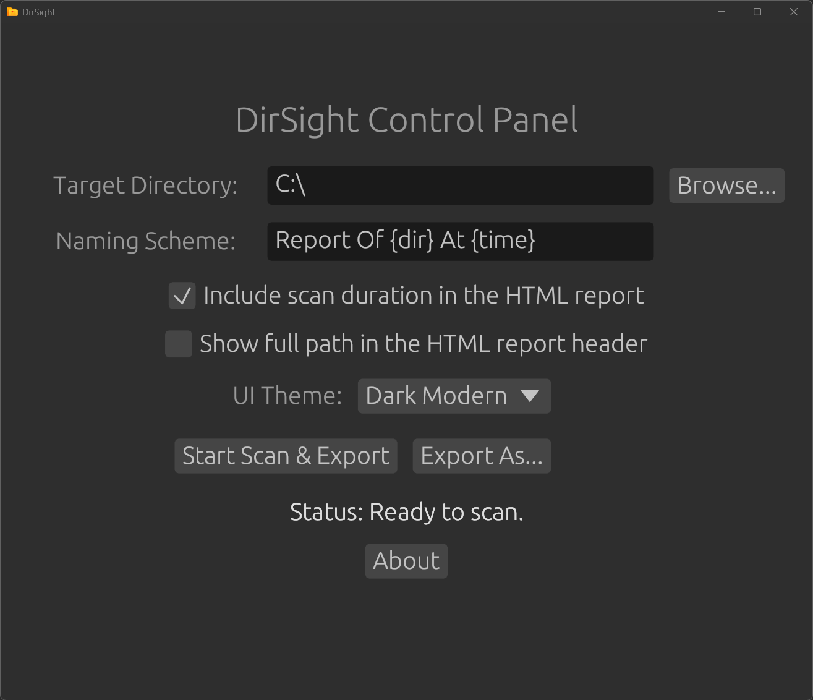
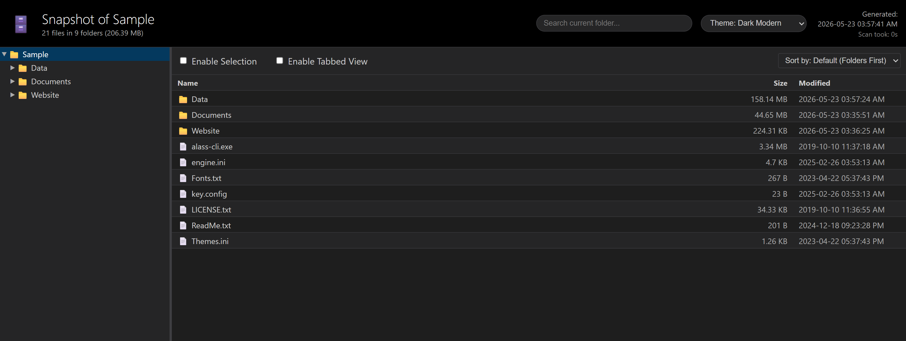

# 🗄️ DirSight

  

A blazing-fast, low-level Windows directory visualizer and scanner built in Rust. It caches file metadata inside an SQLite database and generates feature-rich, fully interactive HTML dashboards, PDFs, and text/markdown reports in seconds.

---

  
   Desktop Control Panel (Built with egui)

---

## ✨ Features

- ⚡ **Direct Win32 Integration** — Bypasses standard Rust recursive routines by calling `FindFirstFileExW` with `FIND_FIRST_EX_LARGE_FETCH` to query the disk at kernel-level speeds.
- 🗃️ **SQL-Backed Cache** — Automatically streams metadata into an indexed SQLite database (`index.db`) within a single optimized transaction.
- 🌐 **Interactive HTML Reports** — Standalone client-side dashboards generated on the fly. *(👉 **[Explore Live Demo](https://mekkihussein.github.io/DirSight/media/Demo.html)**)*
  - **Virtual list rendering** to easily scroll through 100,000+ files without browser lag.
  - **Resizable dual-pane explorer** featuring a collapsible folder tree sidebar.
  - **Multi-select mode** to check custom rows and instantly calculate their total size.
  - **Tabbed view** to open folders in separate browser-like explorer tabs.
  - **Multi-theme support** (Dark Modern, Light Premium, Midnight Purple, and Solarized Dark).
- 📄 **Multi-Format Exports** — Export directory states to interactive HTML, structured Markdown (`.md`), classic text trees (`.txt`), or professional PDF summaries detailing largest folders.
- 🎨 **Real-Time Progress** — Track scan counts and duration directly in the desktop GUI as folders are parsed.

---

  
   Generated Interactive HTML Dashboard (Dark Modern Theme)
    
  <a href="https://mekkihussein.github.io/DirSight/media/Demo.html">
    <strong>🌐 View Live Interactive Demo Report</strong>
  </a>

---

## 🚀 How to Use

1. **Open the App**: Run `DirSight.exe` (or build from source).
2. **Select Target**: Enter your path or click **Browse...** to pick a drive or directory.
3. **Scan & Generate**: Click **Start Scan & Export**. 
4. **Browse Dashboard**: The tool will open the standalone, high-performance HTML dashboard in your default browser.
5. **Additional Formats**: Use **Export As...** to generate PDF summaries, Markdown lists, or raw TXT tree configurations from the cached database index.

---

## 📦 Requirements

* **Operating System**: Windows 10 / 11

